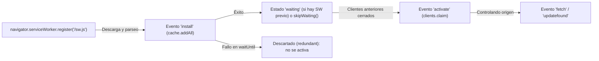

# Sesión 28 (Sesión 2 de 18) — Service Worker del proyecto (1/2)

## Actividad 1 · Traza el ciclo de vida del Service Worker

- **¿Qué pasa si falla el paso de instalación?** Si la promesa pasada a `event.waitUntil()` dentro de `install` es rechazada (por ejemplo, una URL de `CORE_ASSETS` responde 404), el navegador aborta la instalación, descarta este Service Worker y mantiene intacto al anterior si existía (o no instala ninguno).

## Actividad 2 · Detective del Service Worker (DevTools)

- **Estado esperado tras registro inicial:** `activated and is running`.
- **Scope:** `/` (porque `public/sw.js` se sirve directamente en `/sw.js` sin que Vite lo transforme).
- **Versiones simultáneas:** Puede aparecer una segunda versión en estado `waiting to activate` cuando se despliega un `sw.js` nuevo mientras existen pestañas abiertas controladas por la versión anterior.
